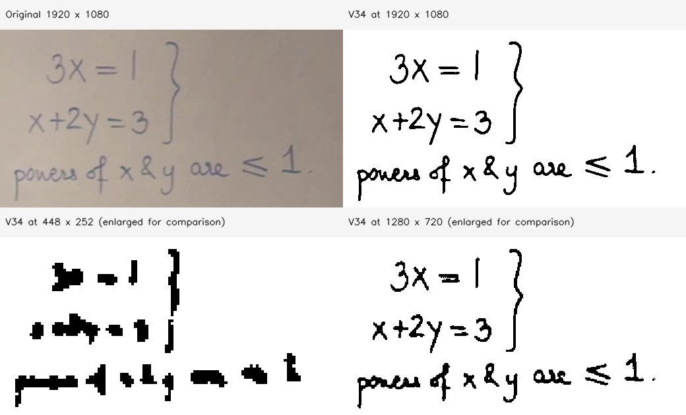

# 작업 기록: V1 구현과 실제 고해상도 판서 품질 검증

작성일: 2026-10-28 (Asia/Seoul)

## 결과 요약

FCN-LectureNet V34와 기존 ST3D를 이용하는 영상→판서 PDF V1을 구현했다.
합성 영상으로 CLI·API·브라우저 흐름을 검증한 뒤, 출력 품질 피드백을 받아 PDF 표시 방식을 보완했다.
이후 공개 AccessMath2015 데이터셋의 **실제 1920×1080 강의 프레임 한 장**으로 해상도별 추론 품질을 비교했다.
이 프레임에서는 원본 1080p를 유지했을 때 저해상도 입력보다 획과 수식이 잘 보존됐다.

**실제 고해상도 연속 영상의 전체 ST3D 처리는 아직 검증하지 않았다.** 아래의 실제 데이터 점수는 한 프레임의 픽셀 평가다.

## 1. V1에서 수행한 작업

- 공식 `kdavila/lecturemath`의 `ACCESS2021_release/` README와 원본 5단계 코드를 분석했다.
- 기존 모델과 CC 분석·그룹화·삭제 이벤트 분할·키프레임 생성 구현을 재사용하는 어댑터를 작성했다.
- 일반 영상의 메타데이터 추출과 기본 1 FPS 샘플링, CPU/CUDA 설정 분리, CLI를 구현했다.
- Linux용 C 라이브러리 빌드 경로, NumPy `np.bool`, 모델의 CUDA 장치 고정을 수정했다.
- 짧은 삭제·다시쓰기에서 이전 판서가 탈락하는 사례를 확인하고, 원본 CC 충돌 그래프상 수명이 분리된 그룹에 보완 분할을 적용했다.
- PDF 생성, FastAPI 비동기 작업·상태·다운로드 API, 단일 추론 슬롯, 입력 제한과 임시 파일 정리를 구현했다.
- 별도 API 주소를 설정할 수 있는 정적 웹 UI를 구현했다. 실제 GitHub Pages 게시나 외부 서버 배포는 하지 않았다.
- 사용자 제공 분할 V34 파일을 연결하고 strict state_dict 로딩으로 실제 CPU 추론을 확인했다.
- 후속 요청에 따라 V34 체크포인트 한 파일은 Git ignore 예외를 두고 추적 대상에 추가했다.

원본 연구 출처와 수정 근거: [UPSTREAM_ANALYSIS.md](UPSTREAM_ANALYSIS.md).
설치·실행: [README](../README.md). 배포·Jetson 안내: [DEPLOYMENT.md](DEPLOYMENT.md).

## 2. 초기 검증과 품질 피드백

초기 검증 영상은 직접 생성한 448×256 MP4였다. 실제 V34로 처리했지만 **실제 강의 영상은 아니다.**
최종 삭제 보존 보완 코드에서 6·24·48초 영상이 각각 2페이지 PDF를 생성했다.
24초 영상에서는 원시 CC 관측 306개를 고유 CC 18개, 그룹 16개로 통합했다.
브라우저 업로드→상태 조회→실제 V34 subprocess→PDF 다운로드도 확인했다.

사용자에게 원본 프레임, 모델 이진화 출력, PDF 삽입 직전 이미지를 제공한 뒤 다음 문제를 확인했다.

- 낮은 입력 해상도에서 이진화한 획을 확대하므로 계단 모양이 두드러진다.
- 일부 `x` 등 수식 획이 모델 출력 단계에서 뭉개진다.
- 단순한 PDF 후처리만으로 누락된 원래 획을 복구할 수 없다.

PDF에 `smooth`/`binary` 스타일을 추가했다. `smooth`는 최종 이진 이미지를 3배 bicubic 보간해 경계 계조를 만든다.
모델·시간적 분석·중복 판정은 계속 원래 이진 마스크로 수행한다. 작은 성분 삭제나 획의 팽창·침식은 적용하지 않았다.
이 처리는 표시 개선이며 새로운 판서 정보를 복원하지 않는다.

후속 자동 테스트: **14 passed, 59 deprecation warnings, 2.92초**.
실제 V34를 사용한 6초 합성 영상의 smooth PDF 생성도 확인했다(2페이지, 7.132초).
픽셀 중심의 원본 값 보존, 작은 점·가는 획, PDF 배치 비율, 저장 PNG와 PDF 삽입 이미지 일치를 검사했다.
세부 결과: [VALIDATION.md](VALIDATION.md).

## 3. 고해상도 실데이터 탐색

작업공간에는 실제 강의 동영상이 없었고, LectureMath XML의 해상도 값은 강제 리사이즈 설정이었다.
따라서 XML에 1080p가 적혀 있다는 사실만으로 고해상도 원본이 있다고 판단하지 않았다.

인터넷 접속을 다시 확인했지만 현재 환경은 제한된 호스트만 허용했다.
YouTube와 데이터셋 원본 Box 주소는 **프록시 CONNECT 단계에서 HTTP 403**을 반환했다.
GitHub는 접근 가능했으므로 공개 연구 저장소에 포함된 실제 프레임과 정답 마스크를 확보했다.
허용되지 않은 접속 경로를 우회하지 않았다.

| 항목 | 확인 내용 |
|---|---|
| 데이터셋 | AccessMath2015 |
| 공개 저장소 | [bhargavaurala/accessmath-icfhr2018](https://github.com/bhargavaurala/accessmath-icfhr2018) |
| 기준 커밋 | `b0278437b977679cf57001d7765227ef9e99038f` |
| 강의 / 키프레임 | `lecture_01` / `10423.png` |
| 실제 이미지 크기 | 원본·정답 모두 1920×1080 |
| 모델 | 사용자가 제공한 FCN-LectureNet V34 |
| 장치 | x86_64 CPU, PyTorch threads=2 |

원본 파일:

- [실제 강의 프레임](https://github.com/bhargavaurala/accessmath-icfhr2018/blob/b0278437b977679cf57001d7765227ef9e99038f/output/annotations/AccessMath2015_lecture_01/keyframes/10423.png)
- [공개 정답 이진 마스크](https://github.com/bhargavaurala/accessmath-icfhr2018/blob/b0278437b977679cf57001d7765227ef9e99038f/output/annotations/AccessMath2015_lecture_01/binary/10423.png)

원본 이미지 SHA-256: `06a4e2cef47d293b56d0d74616b1c033fc93652e7481ecd31c935612693b8c9a`.
V34 SHA-256: `d3721339db6cc2d2de2a29816bfcaca38f2d4c4bc8a1eb75a7402a194604b144`.

## 4. 실제 프레임 평가 방법

같은 원본을 1920×1080, 1280×720, 448×252 세 조건으로 입력했다.
각 조건을 독립 Python 프로세스에서 실행하고 모델 로딩 시간과 추론 시간을 구분했다.
정답 마스크는 추론에 넣지 않고 결과 평가에만 사용했다.

원본 1080p는 2.5MP보다 작아 FCN 원본 코드의 내부 축소 조건에 걸리지 않는다.
입력을 줄인 경우 출력 마스크를 평가 목적으로만 nearest-neighbor로 원본 크기에 투영했다.
흑백 픽셀의 TP/FP/FN으로 Precision, Recall, F1을 계산했다. OCR은 사용하지 않았다.

## 5. 결과

| 입력 | Precision | Recall | 픽셀 F1 | 추론 시간 | 프로세스 최대 RSS |
|---|---:|---:|---:|---:|---:|
| **1920×1080** | 92.44% | 89.17% | **90.77%** | 11.169초 | 3058.38 MiB |
| 1280×720 | 77.04% | 88.14% | 82.22% | 4.958초 | 1580.33 MiB |
| 448×252 | 28.81% | 70.39% | 40.89% | 0.595초 | 526.25 MiB |

추론 시간은 모델 로딩을 제외했다. RSS는 각 프로세스의 high-water mark이며 영상 전체 처리의 메모리 상한이 아니다.
정확한 계수와 출처는 [real-hd-keyframe-results.json](real-hd-keyframe-results.json)에 보존했다.

아래 그림은 같은 좌표의 수식 영역을 비교한다. 저해상도 출력은 비교를 위해 원본 좌표로 확대했으며, 추가 잡음 제거는 하지 않았다.



1080p에서 `3x=1`, `x+2y=3`, 부등호와 본문 획이 더 잘 유지됐다.
희미한 일부 글자의 획 손실과 소량의 배경 오검출은 남았다.
이 샘플에서는 PDF 경계 보간보다 **모델에 입력하는 판서 해상도를 유지하는 효과가 컸다.**

각 해상도에서 한 페이지 PDF도 생성했다. PDF에 실제 삽입된 이미지가 저장된 최종 PNG와 동일함을 확인했다.
이번 PDF에는 시간적 통합을 적용하지 않았다.

## 6. 재현 명령

저장소 루트에서 README의 의존성 설치와 V34 준비를 마친 뒤 실행한다.
결과 경로는 비어 있어야 한다. 네트워크에서는 `raw.githubusercontent.com` 접속이 필요하다.

```bash
mkdir -p benchmark-output/real-hd-accessmath/source

curl -L --fail -o benchmark-output/real-hd-accessmath/source/10423.png \
  https://raw.githubusercontent.com/bhargavaurala/accessmath-icfhr2018/b0278437b977679cf57001d7765227ef9e99038f/output/annotations/AccessMath2015_lecture_01/keyframes/10423.png

curl -L --fail -o benchmark-output/real-hd-accessmath/source/10423-gt.png \
  https://raw.githubusercontent.com/bhargavaurala/accessmath-icfhr2018/b0278437b977679cf57001d7765227ef9e99038f/output/annotations/AccessMath2015_lecture_01/binary/10423.png

for width in 1920 1280 448; do
  python scripts/evaluate_keyframe.py \
    benchmark-output/real-hd-accessmath/source/10423.png \
    --ground-truth benchmark-output/real-hd-accessmath/source/10423-gt.png \
    --width "$width" \
    --output-dir "benchmark-output/real-hd-accessmath/reproduce-$width" || break
done
```

평가 스크립트: [scripts/evaluate_keyframe.py](../scripts/evaluate_keyframe.py).

각 조건의 출력:

- `input.png`: 실제 추론에 입력한 이미지
- `fcn_binary.png`: 실제 V34의 이진화 출력
- `final/page_0001.png`: PDF 삽입 직전 이미지
- `result.pdf`: 단일 프레임 판서 PDF
- `report.json`: 해상도, 모델/입력 해시, 처리 시간, 메모리와 픽셀 점수
- `binary_at_source_size.png`: 좌표 비교·평가용 원본 크기 투영 이미지

이번 실행의 상세 이미지·PDF·ZIP은 `benchmark-output/real-hd-accessmath/`와
`benchmark-output/real-hd-accessmath.zip`에 남겼다. 해당 대용량 실행 결과는 Git ignore 대상이다.
이 문서의 비교 이미지와 요약 JSON은 저장소에 포함해 GitHub에서도 확인할 수 있게 했다.

## 7. 해석의 한계와 다음 검증

- 90.77%는 **한 프레임의 엄격한 픽셀 F1**이다. OCR 정확도나 데이터셋 전체 성능이 아니다.
- 이 프레임의 V34 학습 포함 여부는 확인하지 못했다. 독립 평가셋의 일반화 성능으로 해석하지 않는다.
- 연속 영상의 지움·가림 복원·중복 제거는 이번 실데이터 테스트에서 검증하지 않았다.
- 1080p는 약 3 GiB의 단일 프레임 프로세스 메모리를 사용했다. 전체 ST3D에서는 CC·마스크 메모리가 추가된다.
- 기본 폭 상한 1280은 유지했다. 실제 1080p 보존 비교에는 `--max-width 1920` 또는 `BOARD_MAX_WIDTH=1920`을 사용한다.
- 다음 검증은 실제 1080p 강의의 짧은 연속 구간을 확보해 동일한 세 종류 이미지와 ST3D 보존 품질을 비교하는 것이다.
