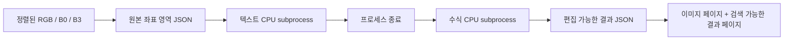

# V2 구현 기록

## 구현 전 상태 확인 (2026-10-28)

브랜치 `work`, HEAD 및 원격 work 모두 `ad45dc4`임을 직접 조회했다.
V1/V1.5 코드·V34가 존재하며, 기술명 PDF 관련 미커밋 변경 3개는 보존한다.
현재 Python 3.12.14 / Torch 2.5.1+cpu / NumPy 1.26.4 / OpenCV 4.10.0,
RAM 제한 8GiB, 가용 디스크 약 29GiB. 기존 V1/V1.5 테스트는 21개다.

- V1: `boardnotes.pipeline.process_video()` → 샘플링/흰 전경 ST3D 마스크 →
  `temporal.summarize()` → 검정 전경 keyframe → `pdf.generate_pdf()`.
- 내부 프레임 시간은 밀리초, PDF keyframe 구간은 초다. V2 JSON timestamp는 초로 고정한다.
- V1 기본 max_width=1280. 원본 모델은 2.5MP 초과만 내부 축소한다.
- V1 keep_intermediates의 masks는 흰 판서/검정 배경, pages는 여백 crop 및 기본 smooth 확대를
  거친 PDF 삽입 이미지다. 이 파일 좌표를 원본 RGB 좌표로 간주하면 안 된다.
- V1.5 `benchmark-output/v1_5-real/`에 원본/GT/RGB/B0/B3 및 확률 캐시가 있다.
  원본은 1920x1080, 이진 출력은 검정 판서/흰 배경으로 좌표가 일치한다.
- V1은 원본 RGB+keyframe 좌표·시간의 V2용 manifest를 아직 내보내지 않는다.
  초기 V2는 명시적 원본 이미지/영역 JSON을 입력받고, 자동 영상 연계와 구분한다.

## 구현 방침

지정 영역 Phase A를 먼저 구현한다. text/formula/other/unknown, 원본 픽셀의
half-open bbox `[x1,y1,x2,y2]`, timestamp 초, 명시적인 성공/빈결과/실패 상태를 사용한다.
자동 영역은 text detector 후보만 만들고 formula라고 단정하지 않는다. 영역 JSON으로 수정 가능해야 한다.
텍스트와 수식 모델은 별도 CPU 프로세스에서 순차 실행하며 부모 프로세스는 Paddle/Torch를 import하지 않는다.
인식 완료 JSON으로 이미지+검색가능 텍스트/LaTeX PDF를 재생성한다. V1의 PDF 함수는 변경하지 않는다.

공식 모델/API와 설치 의존성을 확인하고 아래 고정 환경에서 실제 실행했다. 성능 주장은 결과 문서의 소규모 표본 범위로 한정한다.

## 현재 구현과 경계

지정 영역 Phase A는 실제 CPU 모델로 실행했다. 자동 Phase B는 **OCR line 후보 검출**까지이며,
신뢰할 수 있는 text/formula/graphics 자동 분류는 구현했다고 주장하지 않는다.
후보는 전부 `type=unknown`, `status=needs_review`, `suggested_type=text`로 저장한다.
원본 전체 이미지를 보존하므로 후보 밖 그래프·화살표·가려진 영역을 삭제하지 않는다.
영역 유형은 JSON에서 수정한 후 Phase A로 전달한다. GUI는 없다.



### 모델 및 지원 범위

| 대상 | 실제 선택 | 환경/한계 |
|---|---|---|
| 텍스트 검출 | PP-OCRv5_mobile_det | CPU, 약 4.7MiB 공식 tar |
| 영어/숫자 인식 | en_PP-OCRv5_mobile_rec | CPU, 약 7.6MiB 공식 tar; 영어 손글씨 후보 |
| 한국어 인식 옵션 | korean_PP-OCRv5_mobile_rec | `--language ko`로 별도 모델 선택, 이번에 다운로드/실행하지 않음 |
| 수식 | PP-FormulaNet-S | 약 224MiB 공식 tar; **간단한 인쇄 수식 중심**, 손글씨는 탐색적 검증 |

사용자는 공식 S의 인쇄체 중심 범위를 확인한 후 **S를 먼저 소규모 손글씨 검증**하는 선택을 했다.
S는 deprecated가 아니다. 공식 설명에서 복잡한 인쇄/손글씨 범위는 더 큰 L로 구분한다.
이번에는 L/UniMERNet/pix2tex를 설치하지 않았다. UniMERNet과 pix2tex는 향후 자원/손글씨
평가 후보이며, 이번 실패 결과만으로 자동 교체하지 않는다.

최신 PaddleOCR의 자동 기본 모델은 버전에 따라 달라진다. 따라서 모델명을 모두 명시한다.
`paddleocr==3.3.2`, `paddlex==3.3.11`, `paddlepaddle==3.2.2`를 실제 검증했다.
PaddleX가 opencv-contrib를 요구하므로 기존 Torch/headless OpenCV 환경과 섞지 않는다.
최소 직접 의존성은 `requirements/v2-ocr.txt`, 실제 설치 전체 버전은 `requirements/v2-ocr-lock.txt`다.

공식 근거:

- [Formula API/CPU](https://github.com/PaddlePaddle/PaddleOCR/blob/v3.3.2/docs/version3.x/module_usage/formula_recognition.en.md)
- [S/L의 인쇄/손글씨 범위](https://github.com/PaddlePaddle/PaddleOCR/blob/v3.3.2/docs/version2.x/algorithm/formula_recognition/algorithm_rec_ppformulanet_en.md)
- [PP-OCRv5 API/모델](https://github.com/PaddlePaddle/PaddleOCR/blob/v3.3.2/docs/version3.x/pipeline_usage/OCR.en.md)

## 설치

V1 환경의 ReportLab/Pillow/OpenCV는 그대로 사용한다. OCR만 별도 환경에 설치한다.
GPU, 추가 학습 데이터셋, Torch 재설치는 필요하지 않다.

```sh
python3 -m venv /path/to/ocr-env
/path/to/ocr-env/bin/python -m pip install -r requirements/v2-ocr.txt
# 더 엄밀하게 당시 설치 전체 버전을 재현하려면 v2-ocr-lock.txt 사용
python scripts/v2_fetch_models.py --formula
/path/to/ocr-env/bin/python -m pip check
```

공식 BOS에서 모델 3개만 다운로드하고 URL/크기/아카이브·가중치 SHA256을
`models/v2/models.json`에 남긴다. 모델과 tar는 Git ignore 대상이다.
타르는 중복 다운로드하지 않고 압축 경로 검사를 거쳐 해제한다.
한국어 옵션은 같은 스크립트에 `--language ko`를 지정한다(별도 사전학습 모델).
기본 모델 저장소는 `models/v2`이며 CLI `--model-root`로 변경할 수 있다.

현재 세션 worker Python은 `/workspace/lecturemath-v2-env/bin/python`이다.
기존 부모 실행 환경은 `/workspace/lecturemath-env/bin/python`이며 V1 의존성 일부가
`/tmp/lecturemath-merge-testdeps`에 있어 아래 실제 실행에는 그 PYTHONPATH를 사용했다.
모든 V1 의존성을 정상 설치한 환경에서는 PYTHONPATH 없이 실행한다.

## 실행

### Phase A: 지정 영역

```sh
python -m boardnotes.v2.cli recognize frame.png \
  --region text:965,300,1435,380 --region formula:340,440,515,510 \
  --ocr-python /path/to/ocr-env/bin/python --model-root models/v2 \
  --output /tmp/v2-new --cache-dir /tmp/v2-cache

# 같은 RGB 및 좌표로 B0/B3까지 비교. 이진 이미지는 검정 전경의 native PNG여야 한다.
python -m boardnotes.v2.cli recognize frame.png --regions regions.json \
  --b0 b0.png --b3 b3.png --ocr-python /path/to/ocr-env/bin/python \
  --output /tmp/v2-comparison --cache-dir /tmp/v2-cache
```

`regions.json`은 region list 또는 width/height/regions를 가진 문서다.
영역 유형은 text/formula/other/unknown. other는 그대로 보존하고 unknown은 검토 대기한다.
CLI 반복 `--region`도 지원한다. 영역 JSON의 정답/기존 content는 모델 입력으로 쓰지 않는다.
임의 전체 페이지 수식을 한 덩어리로 보내기보다 의미 있는 crop을 지정한다.
출력 디렉터리는 비어 있어야 한다. 기존 결과를 덮어쓰는 재추론 대신 render를 사용한다.
`--source-variant b0`는 RGB 없이 B0 원본만 입력할 때 명시한다.
`--timestamp`는 **초**이며 모르면 null이다. 프레임 번호를 시간으로 추정하지 않는다.

### Phase B: 자동 후보와 수동 검토

```sh
python -m boardnotes.v2.cli detect frame.png --output /tmp/v2-proposals \
  --ocr-python /path/to/ocr-env/bin/python
# regions.json의 unknown을 text/formula/other로 수정하고 bbox/reading order도 검토
python -m boardnotes.v2.cli recognize frame.png --regions /tmp/v2-proposals/regions.json \
  --output /tmp/v2-reviewed --ocr-python /path/to/ocr-env/bin/python
```

검출 후보를 경계 안으로 제한하고 거의 같은 bbox 중복을 제거한다. 행 밴드 기반 순서는
보조 heuristic일 뿐 분수/위첨자/다중 열의 의미적 읽기 순서가 아니다.
텍스트 인식 crop 안에서는 세로 겹침이 짧은 쪽 높이의 50% 이상인 box를 같은 줄로 묶고,
좌→우로 정렬한다. raw engine 순서/문자열/box도 함께 저장해 재검토할 수 있다.

### PDF 재생성

```sh
python -m boardnotes.v2.cli render edited.json --output /tmp/edited.pdf
# JSON을 다른 폴더로 옮겼거나 원본을 재배치했다면
python -m boardnotes.v2.cli render edited.json --source-image /data/frame.png --output /tmp/edited.pdf
# 한글 등 기본 DejaVu에 없는 문자를 쓰면 그 문자를 포함한 TTF를 명시
python -m boardnotes.v2.cli render edited.json --font /path/to/korean-capable.ttf --output /tmp/edited.pdf
```

전체 원본 raster 페이지에는 crop/overlay/추가 이진화를 하지 않는다.
그 뒤 Unicode 텍스트 및 **literal LaTeX 원문**을 검색/복사 가능한 별도 페이지로 쓴다.
LaTeX 시각 렌더링/수학적 검증/원본 위 OCR text layer는 이번 최소 구현에 포함하지 않는다.
미지원 glyph는 조용히 깨진 글자로 내보내지 않고 명확한 오류를 낸다. JSON은 그대로 남는다.

### V1에서 연결

```sh
python -m boardnotes.cli lecture.mp4 --output-dir /tmp/v1-out --export-v2-inputs
python -m boardnotes.v2.cli recognize /tmp/v1-out/v2_inputs/manifest.json --page 0 \
  --regions composite-regions.json --ocr-python /path/to/ocr-env/bin/python --output /tmp/v2-from-v1
```

새 flag는 기본 False다. 기존 V1 동작/PDF 함수를 교체하지 않는다.
flag를 켜면 **PDF 여백 crop/smooth 이전의 ST3D 합성 키프레임**을 PNG로 저장하고
초 단위 구간/대표 timestamp(구간 끝)/영상 크기/좌표 scale을 manifest에 쓴다.
여러 시점의 합성 판서는 단일 RGB와 일치하지 않으므로 `original_rgb=null`이며 그 한계를 명시한다.
scale은 기하학적 변환이지 동시점 RGB 정렬의 증명이 아니다.
이 manifest로 V2를 실행하면 source variant=b0, 합성 좌표/시간 provenance가 결과 JSON에 남는다.

## JSON 계약

```json
{
  "version": "2.0",
  "source_image": "source.png",
  "width": 1920,
  "height": 1080,
  "timestamp": null,
  "regions": [
    {"id": "eq1", "type": "formula", "bbox": [340, 440, 515, 510],
     "status": "needs_review", "content": null, "latex": null,
     "model": "PP-FormulaNet-S", "confidence": null, "error": null}
  ],
  "metadata": {"input_variant": "rgb"}
}
```

위는 스키마 예시이지 추론 결과가 아니다.

- bbox는 half-open 원본 입력 이미지 좌표 `[x1,y1,x2,y2]`. 크기/유형/중복 id를 검사한다.
- text의 content와 formula의 latex를 별도로 저장한다. 문자열은 Unicode, JSON NaN 금지.
- status=ok는 **모델이 비어 있지 않은 결과를 반환했다**는 의미이지 정답이라는 의미가 아니다.
  empty/failed/preserved/needs_review를 구분한다. 수식 결과는 항상 review_required=true다.
- formula confidence는 모델에서 제공하지 않아 null. text confidence는 비어 있지 않은
  line score의 산술 평균이며 보정된 확률이 아니다. 개별 score와 원출력도 남긴다.
- line_boxes는 crop 기준을 원본 좌표로 offset하고 이미지 밖을 제한한다.
- source_image/crop_image는 절대 경로 또는 JSON 기준 상대 경로를 지원한다.
- metadata에 입력 SHA256, 모델명·버전·파일 fingerprint, 입력 변형, 전처리, 모델별 시간/RSS,
  V1 handoff와 cache hit를 기록한다. 원본 영상 시간이 없으면 timestamp=null이다.
- 모델 로딩/추론 오류도 JSON으로 남기고 원본을 보존한다. CLI는 모델/PDF 실패가 있으면 nonzero 종료한다.

## 캐시·자원 및 교체

캐시 key는 crop PNG SHA256 + 모델 종류/config + 패키지 버전 + worker 코드 + 모델 파일 SHA256이다.
성공/empty 결과만 캐시하며 실패는 재시도할 수 있게 캐시하지 않는다.
같은 입력/설정의 재실행은 캐시를 써서 모델을 다시 로딩하지 않는다.
수치 재현성은 동일 고정 환경과 실제 cache hit로 확인했으며 모든 CPU/버전 간 bitwise 보장은 아니다.

부모는 Paddle/Torch를 import하지 않는다. `worker.py`의 text/formula adapter를 바꾸면 모델을 교체할 수 있다.
모델별 subprocess는 JSON request/response 파일로 통신하고 stdout은 별도 로그다.
타임아웃은 해당 subprocess를 종료하고 원본과 실패 상태를 보존한다.
model_load_seconds는 import+모델 초기화 포함, seconds는 crop predict, subprocess_wall_seconds는
IPC/프로세스 시작 포함이다. worker peak RSS는 그 모델 프로세스 누적 최고치다.

## 검증과 출력

```sh
python -m pytest -q
python -m experiments.v2.benchmark --ocr-python /path/to/ocr-env/bin/python \
  --output benchmark-output/v2/real-final
python -m experiments.v2.report
```

모델 없는 tests/test_v2_*.py의 fixture와 실제 Paddle 결과는 구분한다.
[실제 결과](v2_results.md), [측정 JSON](assets/v2/comparison.json), [대표 PDF](assets/v2/comparison.pdf)를 참고한다.
